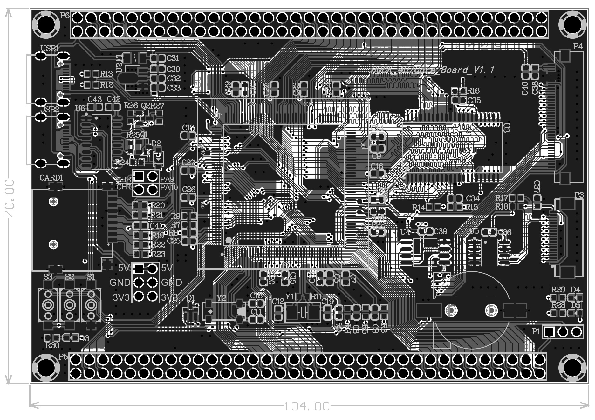

# STM32F407 四层开发板

这是一个基于 STM32F407IGT6 的个人四层开发板设计，用于展示从器件组织、原理图分层到 PCB 布局布线的完整硬件设计过程。仓库保留了可在 Altium Designer 中继续编辑的工程、原理图库、封装库，以及便于直接浏览的设计 PDF 和图片。



## 设计概览

- 核心器件：STM32F407IGT6。
- 板层结构：Top Layer / VCC / GND / Bottom Layer。
- 存储资源：IS61LV25616 SRAM、W25Q128 Flash、AT24C02 EEPROM。
- 外设与接口：SD 卡、LCD、Camera、USB OTG、CH340C 串口/下载电路、扩展排针与测试接口。
- 设计范围：3 页原理图、4 层 PCB、项目专用原理图库和封装库。

## 可直接查看

- [完整设计 PDF](docs/stm32f407-four-layer-board.pdf)
- [Altium 工程源文件](altium/)
- [MCU、电源与基础电路预览](images/schematic-mcu-and-power.jpg)
- [存储器与外设预览](images/schematic-memory-and-peripherals.jpg)
- [扩展接口预览](images/schematic-expansion-headers.jpg)

## 设计思路

1. 原理图按 MCU 与电源、存储与外设、扩展与测试接口拆分，降低单页复杂度。
2. VCC 和 GND 使用独立内层，顶层与底层用于器件布局、信号布线和局部覆铜。
3. MCU 周围集中布置去耦器件，并按功能区域组织外部存储、下载通信和扩展接口。
4. 项目使用的自建符号库与封装库随工程一起保存，避免依赖个人电脑上的绝对路径。

## 目录说明

```text
.
├── altium/
│   ├── project.PrjPcb          # Altium 工程入口
│   ├── Sheet1-3.SchDoc         # 三页原理图
│   ├── PCB1.PcbDoc             # 四层 PCB
│   ├── Schlib1.SchLib          # 项目原理图库
│   └── PcbLib1.PcbLib          # 项目封装库
├── docs/
│   └── stm32f407-four-layer-board.pdf
└── images/                     # GitHub 预览图
```

使用 Altium Designer 打开 `altium/project.PrjPcb` 即可查看工程。工程文档和项目库均使用相对路径组织。

## 当前边界

本目录展示的是设计阶段成果，未在仓库中声明已经完成打样或整板硬件验证。生产前仍需在目标 Altium 版本中重新编译工程，执行 ERC/DRC，并结合器件实物、板厂工艺和最新数据手册复核封装、叠层、阻抗、电源完整性与可制造性。仓库未包含 Gerber、钻孔、贴片坐标或采购 BOM，因此不应直接作为生产包使用。

## 公开内容说明

这里只发布个人设计源文件与本人导出的预览资料。课程讲义、芯片数据手册、第三方集成库、历史备份和临时文件均未纳入仓库。
